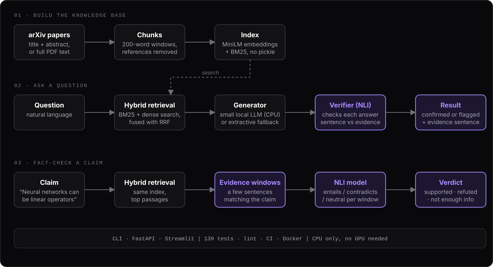
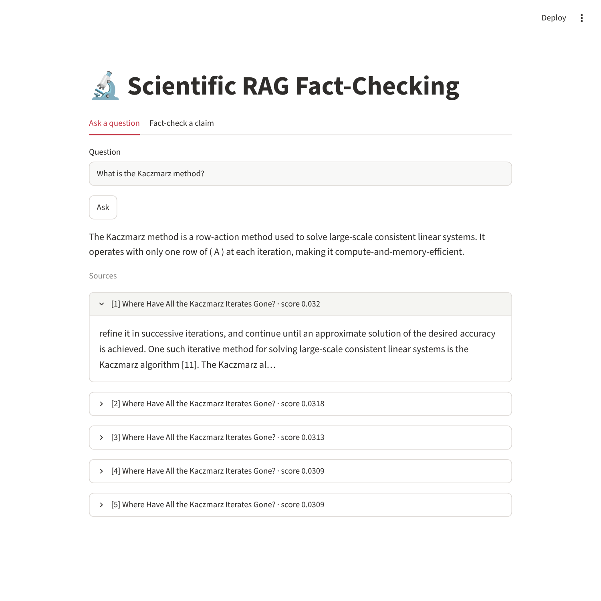
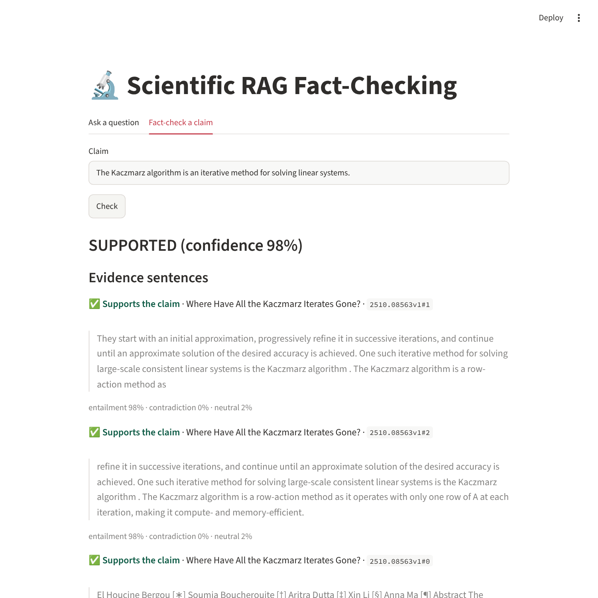
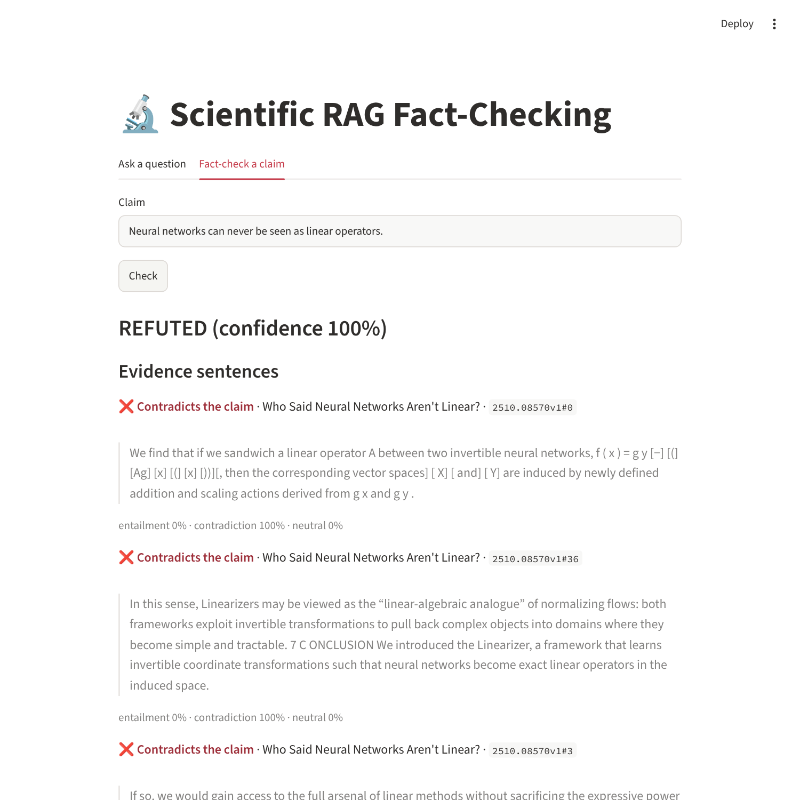
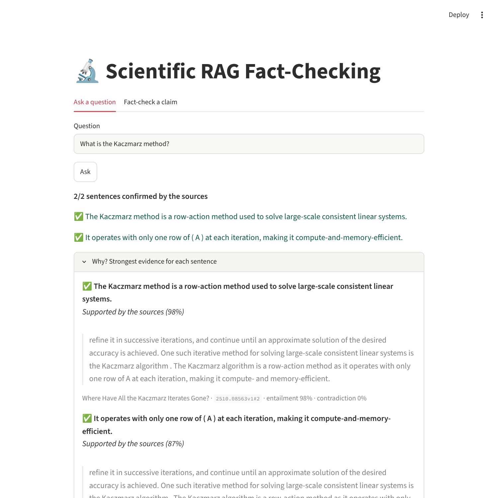
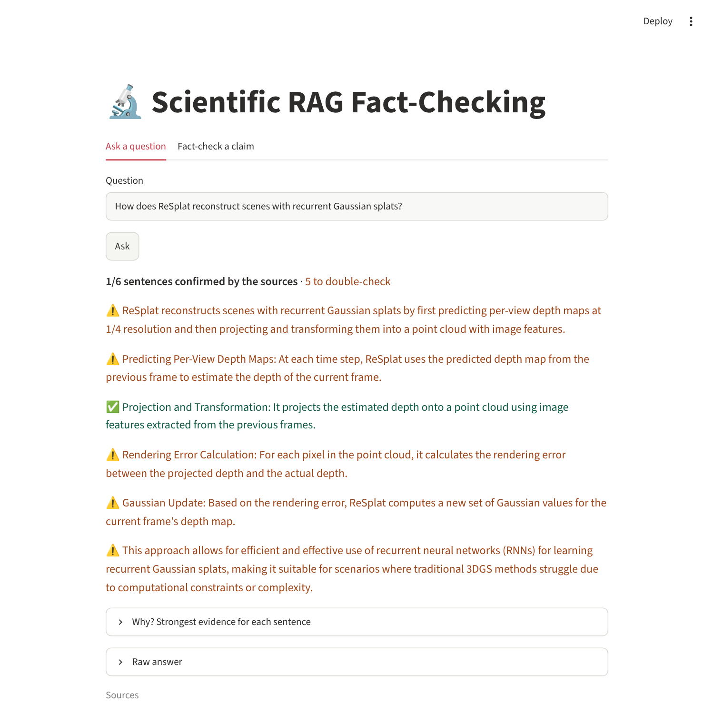

<div align="center">

# 🧠 RAG Fact-Checking

[](https://github.com/Corrosifu/RAG_Fact_Checking/actions/workflows/ci.yml)
[](https://www.python.org/)
[](https://fastapi.tiangolo.com/)
[](https://streamlit.io/)
[](https://www.docker.com/)

A **lightweight, explainable Retrieval-Augmented Generation** system to answer questions about
scientific papers (arXiv) and verify claims against them — designed to run on a **small machine**:
no GPU and no model download required.

</div>

<p align="center">
  <br>
  <em>Original architecture diagram (ingestion → retrieval → generation).</em>
</p>

## Quick start (offline, ~1 second)

```bash
pip install -e ".[dev,ui]"     # core needs only numpy + requests

ragfc sample                   # writes the bundled demo corpus to data/
ragfc index                    # chunk + embed + build the index
ragfc ask "How does quantization reduce model size?"
ragfc eval                     # retrieval metrics on the bundled test set
```

Run the API and the UI:

```bash
ragfc serve                                    # http://127.0.0.1:8000/docs
BACKEND_URL=http://localhost:8000 streamlit run ui/streamlit_app.py
```

Use your own arXiv corpus instead of the demo one:

```bash
ragfc ingest --topic "quantization" --max-results 20        # title + abstract
ragfc ingest --topic "quantization" --full-text             # PDFs (pip install -e ".[pdf]")
ragfc index
```

## Screenshots

Streamlit UI running **fully locally on CPU** (MiniLM embeddings, Qwen2.5-0.5B generator,
NLI verifier) over 10 arXiv papers.

**Ask a question** — a grounded answer with its cited sources:

<p align="center">
  
</p>

**Fact-check a claim** — a verdict plus the exact sentences used as evidence, each with its
source and NLI probabilities:

<table>
  <tr>
    <td align="center"><b>Supported claim</b><br>
      </td>
    <td align="center"><b>Refuted claim</b><br>
      </td>
  </tr>
</table>

**Answer verification** — with the NLI verifier enabled, every sentence of a generated answer is
checked against the retrieved sources. Left: a faithful answer (2/2 confirmed, with the supporting
evidence). Right: an answer from a 0.5B model where 5 of 6 sentences are flagged to double-check.

<table>
  <tr>
    <td align="center"><b>Faithful answer</b><br>
      </td>
    <td align="center"><b>Partly invented answer</b><br>
      </td>
  </tr>
</table>

> Small local models can still write fluent but ungrounded answers — always check the cited
> sources, and use the fact-checker for claims that matter (see [Limitations](#limitations)).

## How it works

```
arXiv → documents (JSONL) → word-window chunks → embeddings ─┐
                                                              ├─ RRF fusion → (reranker) → generator → answer + sources
                                         BM25 (lexical) ──────┘                          └→ NLI verifier → verdict
```

| Stage | Default (small machine) | Optional upgrade (`pip install -e ".[ml]"`) |
|---|---|---|
| Embeddings | `hashing` – feature hashing of word uni/bi-grams, deterministic, no download | `sentence-transformers` (`all-MiniLM-L6-v2`, ~90 MB) |
| Retrieval | exact cosine (numpy) + BM25, fused with **Reciprocal Rank Fusion** | + cross-encoder reranker (`RAGFC_RERANKER=cross-encoder`) |
| Generation | `extractive` – selects and cites the best evidence sentences | `hf` – small instruct LLM, CPU or GPU (`Qwen2.5-0.5B-Instruct` by default; Llama-3.2-1B works with `HF_TOKEN`) |
| Answer check | off without a verifier | `nli` – each sentence of the generated answer is checked against the sources (`RAGFC_VERIFY_ANSWERS=false` to disable) → ✅ supported / ❌ contradicted / ⚠️ not confirmed |
| Fact-check | disabled (returns HTTP 501) | `nli` – entailment/contradiction over short evidence windows (a few sentences) selected from the retrieved passages → `SUPPORTED` / `REFUTED` / `NOT_ENOUGH_INFO` |

Everything is selected with environment variables (see [`.env.example`](.env.example)):

```bash
RAGFC_EMBEDDER=sentence-transformers RAGFC_GENERATOR=hf RAGFC_VERIFIER=nli ragfc check "Quantization reduces model size."
```

> The `hashing` embedder and `extractive` generator are deliberately simple fallbacks so the
> project works anywhere. For real semantic quality use the `[ml]` backends.

## API

| Endpoint | Body | Returns |
|---|---|---|
| `GET /health` | – | `{"status": "ok"}` |
| `POST /query` | `{"query": "...", "top_k": 5, "verify": true}` | `{"text": "...", "sources": [...], "checks": [{sentence, status, confidence, evidence}]}` (`checks` is empty without a verifier) |
| `POST /fact-check` | `{"claim": "...", "top_k": 5}` | `{"verdict", "confidence", "evidence": [...]}` (needs `RAGFC_VERIFIER=nli`) |

Errors are real HTTP codes: `422` invalid input, `503` index not built, `501` verifier not configured.

## Docker

```bash
docker compose run --rm backend ragfc sample && docker compose run --rm backend ragfc index
docker compose up --build        # API :8000, UI :8501 (CPU, ./data mounted)

# neural models / NVIDIA GPU
docker compose -f docker-compose.yml -f docker-compose.gpu.yml up --build
```

Azure App Service deployment: [docs/azure.md](docs/azure.md).

## Project layout

```
src/rag_fact_checking/
  config.py        env-driven Settings          retriever.py   BM25 + dense + RRF (+ reranker)
  ingestion.py     arXiv Atom API → documents   generation.py  extractive / HF generators
  chunking.py      word-window chunker          verifier.py    NLI claim verification
  embeddings.py    hashing / sentence-transf.   pipeline.py    RAGPipeline (ask, fact_check)
  index.py         numpy index (no pickle)      api.py · cli.py · client.py
  evaluation/      retrieval metrics (+ RAGAS)  sample/       bundled demo corpus + test set
ui/streamlit_app.py   docker/   docs/   tests/
```

## Development

```bash
pip install -e ".[dev]"
make test      # pytest + coverage (no network, no model downloads)
make lint      # ruff
```

The test suite uses the real pipeline on the bundled corpus plus stubs for the heavy models, so
it runs in about a second. CI runs lint + tests on Python 3.10 and 3.12.

## Evaluation

`ragfc eval` reports **hit-rate@k, recall@k and MRR** from a JSONL test set
(`{"query": ..., "relevant_doc_ids": [...]}`) — fast, deterministic, no LLM judge. An optional
RAGAS wrapper lives in `rag_fact_checking.evaluation.ragas_eval` (`pip install -e ".[eval]"`,
experimental, not covered by CI).

## Limitations

- English text only; PDF extraction is text-only (no tables/figures).
- The default `hashing` embedder is lexical-ish; use `sentence-transformers` for semantic matching.
- The flat numpy index is exact and simple, sized for up to tens of thousands of chunks
  (~8 KB/chunk at 2048 dims); beyond that, switch to an ANN index.
- Verdicts come from a small NLI model over retrieved passages: treat them as decision support,
  not ground truth. Conflicting evidence (strong support *and* strong contradiction) yields
  `NOT_ENOUGH_INFO` rather than a guess. Checked by hand on 7 claims over 10 papers: no
  confidently wrong verdict, 2 conservative `NOT_ENOUGH_INFO` — a sanity check, not a benchmark.
- Answer verification is a **filter, not a guarantee**: on a handful of cases it flagged the invented
  sentences of a 0.5B model and confirmed a faithful answer, but it can miss an invented clause
  inside an otherwise supported sentence, and flag faithful sentences that combine facts spread
  over several source sentences. Read "not confirmed" as "double-check this".
- Tiny generators (`Qwen2.5-0.5B`) write fluent but sometimes **ungrounded** answers: always read
  the cited sources, and use the fact-checker on claims you care about.

## Migrating from v0.1

The v0.1 layout (`API/`, `RAG/`, `Evaluation/`, FAISS + LangChain, Llama-3.2-1B) was replaced by the
`src/` package above. Prebuilt indexes, PDFs and `__pycache__` are no longer versioned: rebuild with
`ragfc ingest && ragfc index`. The old files remain available in the git history.

---

Author: [Corrosifu](https://github.com/Corrosifu)
